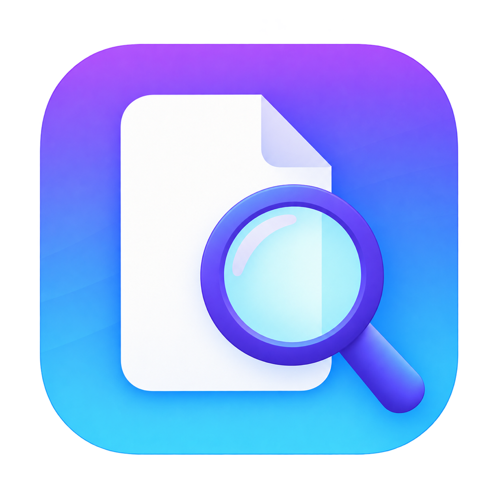
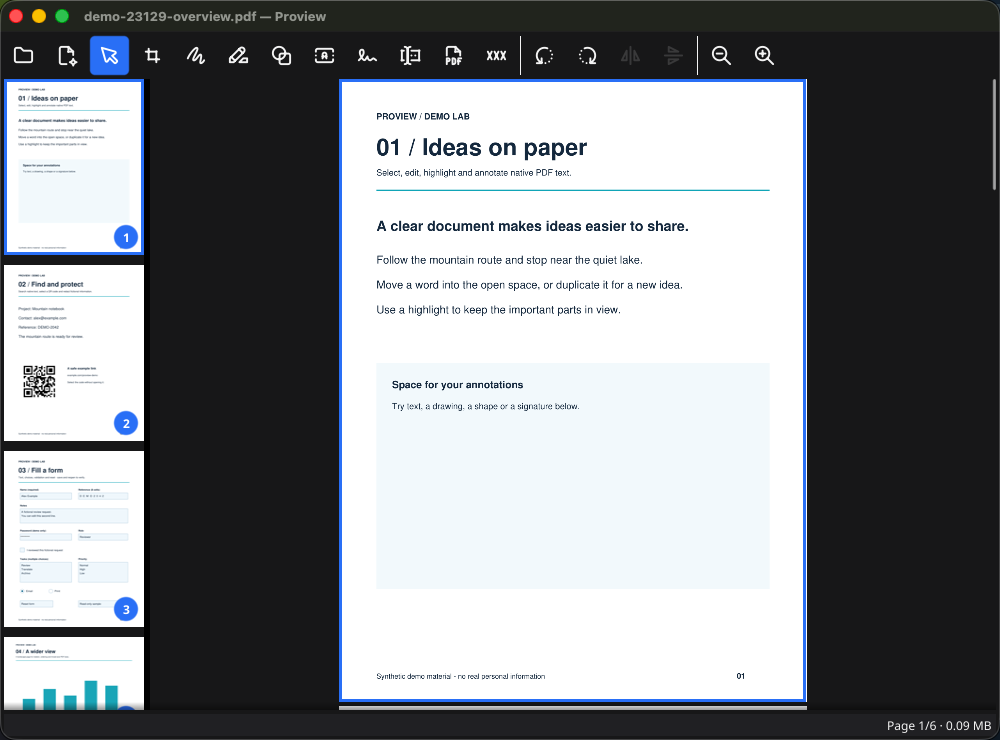
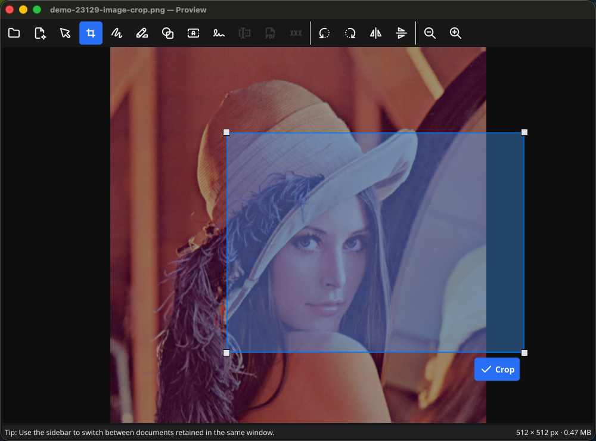
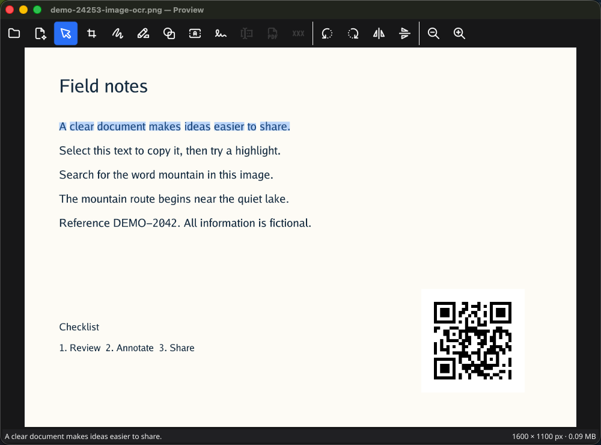
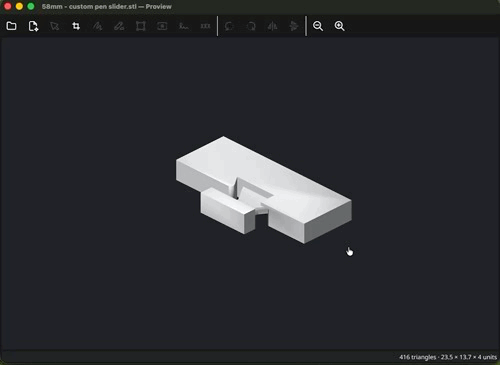
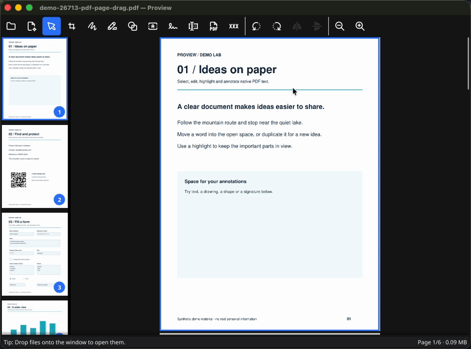
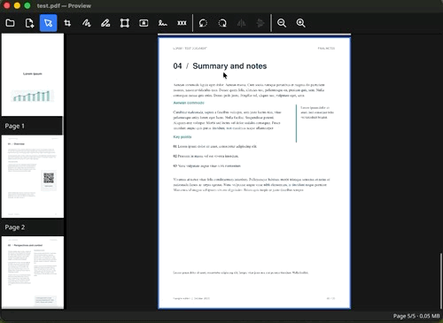
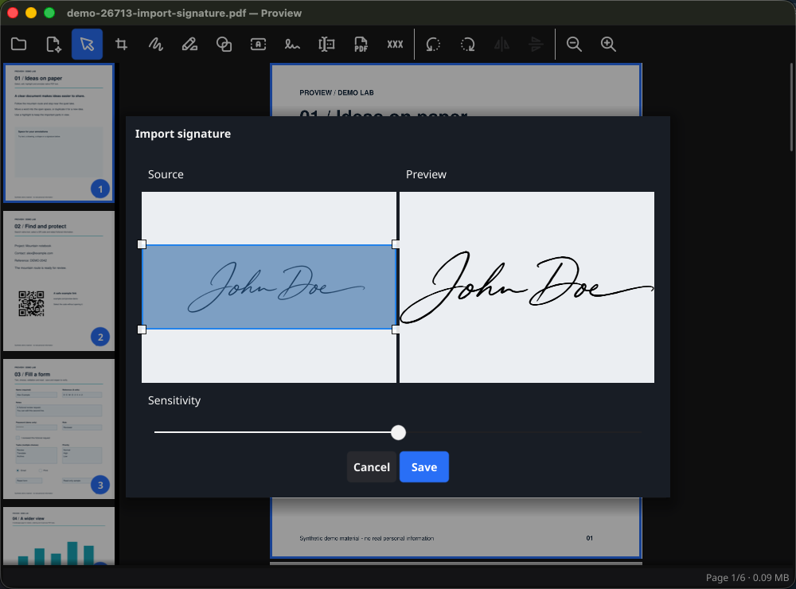
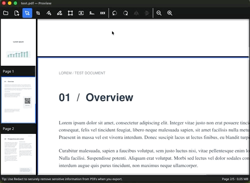

<p align="center">
  
</p>

# Proview

A simple desktop app for quickly viewing and making basic edits to common file formats on Linux, Windows and macOS.

## Motivation

One of the things I miss most when I switch from macOS to other systems is the Preview app. I know, it's a small thing, but it can make a big difference in everyday work: cropping and annotating a screenshot, signing a PDF or highlighting a paragraph, adding quick annotations, and so on.

If you've ever used it, you know it's not just about the number of features, but how naturally they fit into a simple interface.

I've never found an alternative that felt right for me across platforms. With the help of AI, I was finally able to build my own. I hope you like it too.

Proview is an independent project and is not affiliated with, sponsored by, or endorsed by Apple Inc.

<a href="docs/screenshots/overview.png" target="_blank" rel="noopener noreferrer">
  
</a>

## Features

Drag files onto any Proview window to open them on Linux, Windows and macOS.
An empty window opens the first file; additional files, or files dropped onto an
occupied window, retain documents in the same window with a sidebar selector.
Opening a PDF while viewing a PDF offers a new window or appending its pages.
See [Document workspace](docs/document-workspace.md) for the current local behavior.

### Image viewing and basic editing

Proview opens the most common image formats and supports basic editing, such as cropping, rotating and annotating.

<a href="docs/screenshots/image-editing.png" target="_blank" rel="noopener noreferrer">
  
</a>

It also has a built-in OCR engine that recognizes text in images and scanned documents, making it easy to copy text or open links.

<a href="docs/screenshots/ocr.png" target="_blank" rel="noopener noreferrer">
  
</a>

Proview also opens ASCII and binary STL files, letting you inspect 3D models with rotation, panning and zoom. You can switch between standard views, toggle wireframe, and crop the current view into an image.

<a href="docs/screenshots/stl.gif" target="_blank" rel="noopener noreferrer">
  
</a>

### PDF markup and organization

For PDF documents, Proview also lets you highlight text, redact sensitive content, and add, remove, reorder or rotate pages.

Highlight follows words and lines at a fixed 30% opacity, using native PDF text
or recognized text in images. Draw offers round freehand strokes, dashed and
dotted patterns, and adjustable opacity.
You can also combine multiple PDFs into one document, or split a PDF into separate files.

All PDF operations preserve native PDF content: added text, ordinary shapes and vector signatures are exported as vector content rather than flattening the whole page into a bitmap.

<a href="docs/screenshots/pdf.gif" target="_blank" rel="noopener noreferrer">
  
</a>

### Add handwritten signatures

Signing documents is still a common task in the digital age, and we have to accept that.
What shouldn't be necessary is printing, signing and scanning a document just to send it back.

Proview lets you capture your signature once and add it to any document with a single click.

<a href="docs/screenshots/sign-pdf.gif" target="_blank" rel="noopener noreferrer">
  
</a>

You can draw your signature with a mouse or a stylus, or import it from a photo or scan.
For imported signatures, the background is removed automatically and the signature is vectorized, so you can scale it without losing sharpness.
You can save signatures to the cloud (S3-compatible storage or Google Drive) and use them across different computers.

Google Drive sync uses the published Proview OAuth app. Cloud sync is optional and uploads your saved signature library. Documents opened for editing stay on your computer. See the [cloud sync guide](docs/signature-cloud-sync.md) for setup and storage details.

<a href="docs/screenshots/import-signature.png" target="_blank" rel="noopener noreferrer">
  
</a>

### Remove sensitive PDF content

The **Redact PDF** tool marks words, lines or rectangular regions for removal. When you export, Proview removes the underlying content and sanitizes the PDF, including metadata, attachments and other supported document structures.

<a href="docs/screenshots/redaction.gif" target="_blank" rel="noopener noreferrer">
  
</a>

### Fill PDF forms

Use **Fill PDF form** to edit supported fields directly on the page. Text,
passwords, checkbox/radio controls, dropdowns and single/multiple-selection lists
remain editable after saving. Standard ResetForm buttons restore field defaults;
missing required values are marked without blocking draft saves. Current scope,
limitations and development status are in [PDF forms](docs/pdf-forms.md).

### Search and edit PDF text

Find searches the entire document, using native PDF text or available OCR for
images/scanned pages. The **Edit PDF Text** prototype supports small corrections
and mouse positioning of native words, with Undo and searchable PDF output.
It does not reflow surrounding text or edit scanned lettering. See
[document search](docs/text-search.md) and [native text editing](docs/pdf-text-editing.md)
for scope and current limits.

## Get Proview

Builds are available from the repository's [Releases](../../releases).

| Platform | Package |
| --- | --- |
| macOS, Apple Silicon or Intel | ZIP containing `Proview.app` |
| Windows, x64 | ZIP containing `proview.exe` |
| Linux, x64 or ARM64 | AppImage |

### Build and contribute

Proview is written in Go with Fyne, using MuPDF and pdfcpu for PDF work and Tesseract for OCR. Build dependencies include Go 1.26+, Python 3.10+, Task and the native libraries for your platform.

```sh
task run     # Run the app
task check   # Run tests and static checks
task build   # Build for the current platform
```

See [Development and packaging](docs/development.md) for setup, native and cross builds, release workflows and local data locations. Project conventions are in [agent.md](agent.md); the [documentation map](docs/README.md) links feature status, plans and evaluation records. Third-party notices are available in the app under **Help → Third-Party Licenses**; icon provenance is documented in [assets/README.md](assets/README.md).

## What could come next

These are directions to explore, rather than a release schedule:

- **Full GIF support:** animation playback, frame editing and GIF export.
- **Full TIFF support:** navigating and editing every page, plus TIFF export.
- **More image formats:** HEIC/HEIF and AVIF.
- **Certificate-based PDF signatures:** [detection, verification and signing plan](docs/pdf-digital-signatures.md), separate from visible handwritten signatures.
- **Markdown viewing:** read rendered Markdown documents.
- **Better recognition and signature acquisition:** more OCR languages, mixed text/image PDF pages, and better handling of photographed signatures, shadows and paper backgrounds.
- **Easier distribution:** macOS Developer ID signing and notarization, and broader testing across desktop environments.

The aim is to keep useful everyday tools close at hand while preserving a simple interface.

## License

Copyright (C) 2026 Emanuele Longo.

Proview is licensed under the **GNU Affero General Public License, version 3
or any later version (AGPL-3.0-or-later)**. See [LICENSE](LICENSE) and
[NOTICE](NOTICE). Third-party components retain their respective licenses;
see the [dependency license review](docs/licensing.md).
