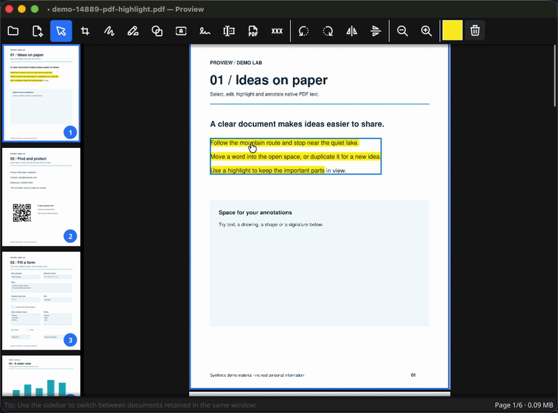
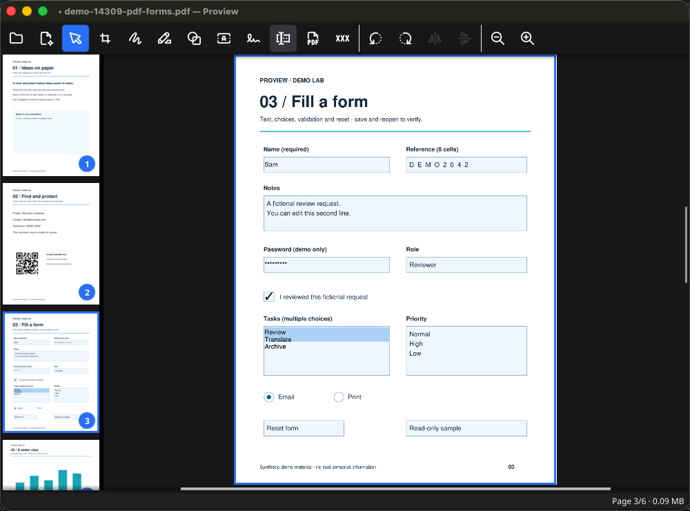
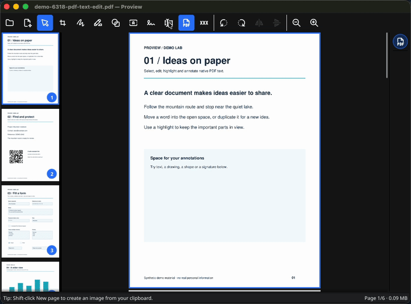
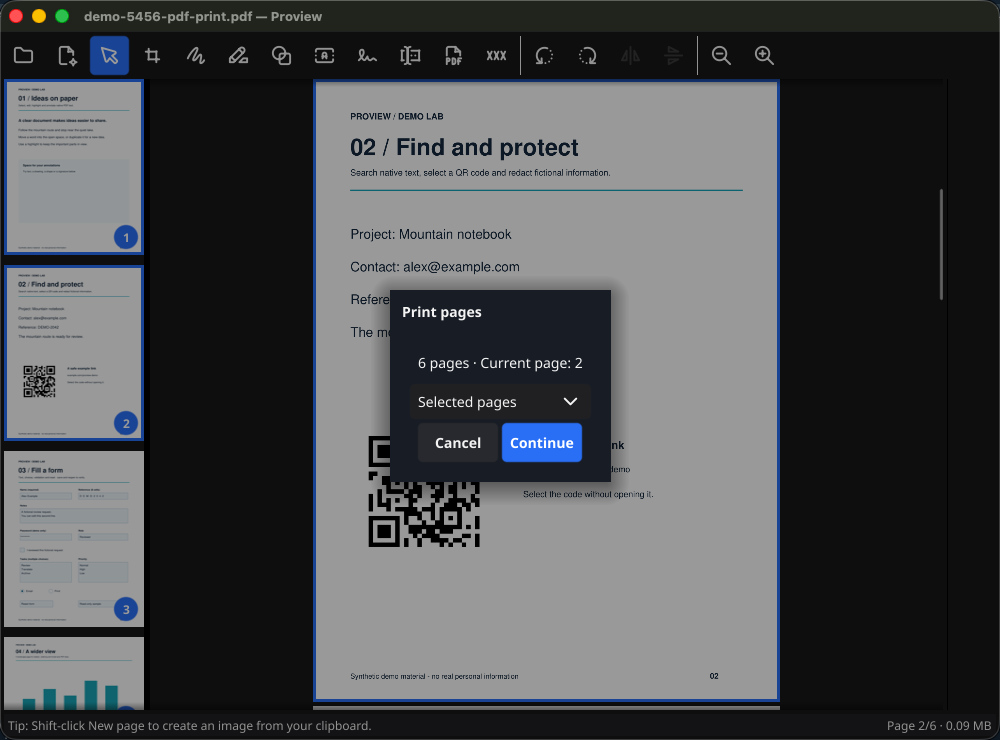
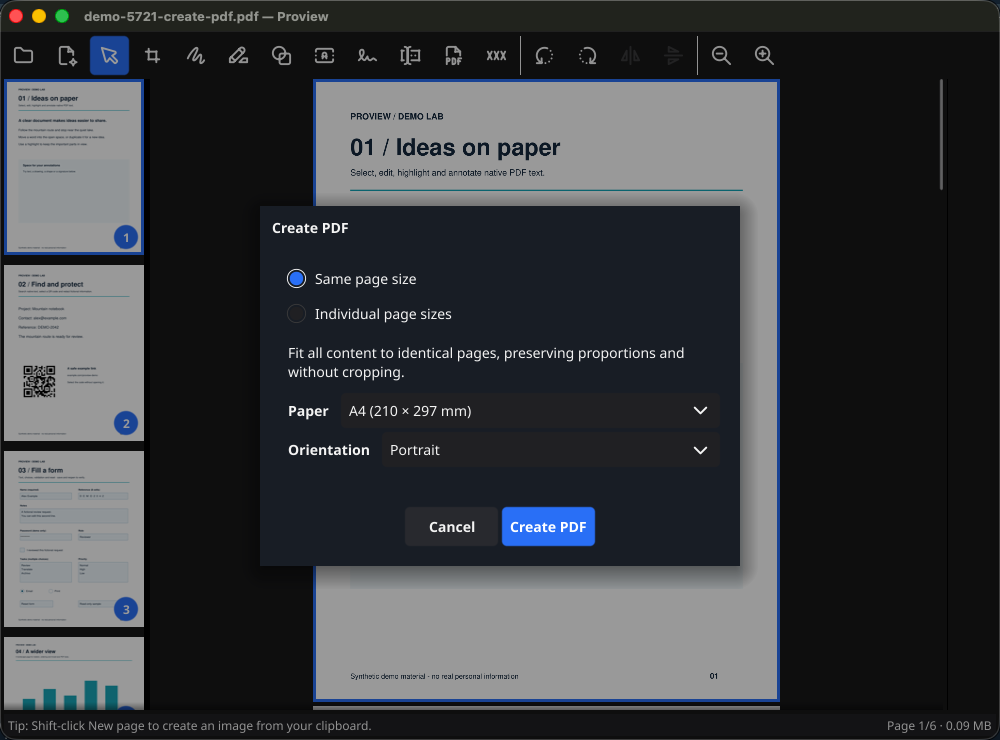
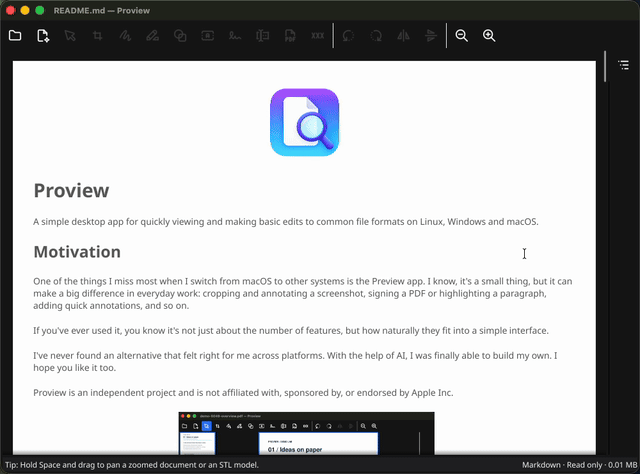

<p align="center">
  
</p>

# Proview

A simple desktop app for quickly viewing and making basic edits to common file formats on Linux, Windows and macOS.

## Motivation

One of the things I miss most when I switch from macOS to other systems is the Preview app. I know, it's a small thing, but it can make a big difference in everyday work: cropping and annotating a screenshot, signing a PDF or highlighting a paragraph, adding quick annotations, and so on.

If you've ever used it, you know it's not just about the number of features, but how naturally they fit into a simple interface.

I've never found an alternative that felt right for me across platforms. With the help of AI, I was finally able to build my own. I hope you like it too.

Proview is an independent project and is not affiliated with, sponsored by, or endorsed by Apple Inc.

<a href="docs/screenshots/overview.png" target="_blank" rel="noopener noreferrer">
  
</a>

## Features

Open files from your desktop or drag them onto a Proview window. Switch between
images, Markdown documents and STL models in the sidebar. PDFs open in separate
windows, with the option to append pages when another PDF is already open.
See [Document workspace](docs/document-workspace.md) for details.

### Image viewing and basic editing

Proview opens the most common image formats and supports basic editing, such as cropping, rotating and annotating.
Animated GIFs play both when opened directly and inside Markdown documents.
Editing a GIF uses its first frame; frame editing and GIF export are not supported.

<a href="docs/screenshots/image-editing.png" target="_blank" rel="noopener noreferrer">
  
</a>

It also has a built-in OCR engine that recognizes text in images and scanned PDFs, making it easy to select and copy text, open links or search with **Ctrl/Command+F**. OCR runs locally; recognized text is searchable inside Proview but is not embedded in saved files.

<a href="docs/screenshots/ocr.png" target="_blank" rel="noopener noreferrer">
  
</a>

### PDF markup and organization

Add text directly on the page, draw, place shapes and highlight words or whole
paragraphs. Highlights follow native or recognized text and keep dark lettering
readable. Select a highlight to change its color. Draw offers round freehand strokes, dashed and dotted patterns, and
adjustable opacity. A magnifier lets you inspect small details while editing.

<a href="docs/screenshots/highlight.gif" target="_blank" rel="noopener noreferrer">
  
</a>

Added text, drawings, highlights and shapes remain editable after saving and
reopening a PDF, using standard PDF annotations. Supported annotations created
in other editors, including macOS Preview, can also be edited in Proview. See
[PDF annotations](docs/pdf-annotations.md) for compatibility and limits.

Organize pages by dragging their thumbnails. Select several pages to move,
duplicate or delete them together; add blank pages, rotate pages, combine PDFs
or split a document into separate files.

PDF edits preserve native text and vector content. Text stays searchable, and
page previews adapt to zoom and display density for sharper viewing.

<a href="docs/screenshots/pdf.gif" target="_blank" rel="noopener noreferrer">
  
</a>

### Fill PDF forms

Use **Fill PDF form** to edit supported fields directly on the page. Text,
passwords, checkbox/radio controls, dropdowns and single/multiple-selection lists
remain editable after saving. Standard ResetForm buttons restore field defaults;
missing required values are marked without blocking draft saves. Current scope,
limitations and development status are in [PDF forms](docs/pdf-forms.md).

<a href="docs/screenshots/forms.png" target="_blank" rel="noopener noreferrer">
  
</a>

### Add handwritten signatures

Signing documents is still a common task in the digital age, and we have to accept that.
What shouldn't be necessary is printing, signing and scanning a document just to send it back.

Proview lets you capture your signature once and add it to any document with a single click.

<a href="docs/screenshots/sign-pdf.gif" target="_blank" rel="noopener noreferrer">
  
</a>

You can draw your signature with a mouse or a stylus, or import it from a photo or scan.
For imported signatures, the background is removed automatically and the signature is vectorized, so you can scale it without losing sharpness.
You can save signatures to the cloud (S3-compatible storage or Google Drive) and use them across different computers.

> [!NOTE]
> Cloud sync is optional and uploads your saved signature library. Documents opened for editing stay on your computer.

Google Drive sync uses the published Proview OAuth app. See the [cloud sync guide](docs/signature-cloud-sync.md) for setup and storage details.

<a href="docs/screenshots/import-signature.png" target="_blank" rel="noopener noreferrer">
  
</a>

### Search and edit PDF text

Find (**Ctrl/Command+F**) searches the entire document, using native PDF text or
OCR text in images and scanned PDF pages. OCR search works inside Proview;
it does not add a searchable text layer to exported PDFs.
The **Edit PDF Text** prototype supports small text edits,
moving and duplicating native words, with Undo and searchable PDF output.
It does not reflow surrounding text or edit scanned lettering. See
[document search](docs/text-search.md) and [native text editing](docs/pdf-text-editing.md)
for scope and current limits.

<a href="docs/screenshots/pdf-text-edit.gif" target="_blank" rel="noopener noreferrer">
  
</a>

### Remove sensitive PDF content

The **Redact PDF** tool marks words, lines or rectangular regions for removal. When you export, Proview removes the underlying content and sanitizes the PDF, including metadata, attachments and other supported document structures.

<a href="docs/screenshots/redaction.gif" target="_blank" rel="noopener noreferrer">
  
</a>

### Print and create PDFs

Print PDFs, images and Markdown with **Ctrl/Command+P**, including your unsaved
edits. Choose all PDF pages, the current page, a range or selected thumbnails,
then use the system print dialog.

<a href="docs/screenshots/printing.png" target="_blank" rel="noopener noreferrer">
  
</a>

Use **Create PDF from Selection** to turn selected pages, images or Markdown
into a new PDF. Keep individual page sizes or fit everything onto A4, US Letter
or a custom sheet. Original files stay unchanged. See [Printing](docs/printing.md)
for details.

<a href="docs/screenshots/create-pdf.png" target="_blank" rel="noopener noreferrer">
  
</a>

### Resume your files

Launch `proview` without file arguments to reopen the previous session.
Each window remembers its file set on closing; the last window closed wins.
Sessions remember file paths, so save document edits separately. Launching with
file arguments opens those files instead.

### Read Markdown

Read Markdown with formatted text, tables, local images, syntax-highlighted code
and Mermaid diagrams. GitHub alerts and Docusaurus callouts highlight useful
notes; expandable sections keep extra details close at hand. Select and copy
text, adjust the reading size, choose a light or dark page, and use Contents to
jump between headings. Animated local GIFs play inside the page. Everything renders
offline; source files stay unchanged. See [Markdown viewer](docs/markdown-viewer.md)
for supported syntax.

<a href="docs/screenshots/markdown.gif" target="_blank" rel="noopener noreferrer">
  
</a>

> [!TIP]
> Click a section's title to expand it, or click an image or Mermaid diagram for a larger, zoomable preview. Use **Ctrl/Command+P** to print the complete document, including collapsed sections.

### View 3D models

Proview opens ASCII and binary STL files, letting you inspect 3D models with rotation, panning and zoom. You can switch between standard views, toggle wireframe, and crop the current view into an image.

<a href="docs/screenshots/stl.gif" target="_blank" rel="noopener noreferrer">
  
</a>

## Get Proview

Builds are available from the repository's [Releases](../../releases).

| Platform | Package |
| --- | --- |
| macOS, Apple Silicon or Intel | ZIP containing `Proview.app` |
| Windows, x64 | ZIP containing `proview.exe` |
| Linux, x64 or ARM64 | AppImage |

### Build and contribute

<details>
<summary>Build from source and run the checks</summary>

Proview is written in Go with Fyne, using MuPDF and pdfcpu for PDF work and Tesseract for OCR. Build dependencies include Go 1.26+, Python 3.10+ with safe tar extraction support, Task and the native libraries for your platform.

```sh
task run     # Run the app
task check   # Run tests and static checks
task build   # Build for the current platform
```

</details>

See [Development and packaging](docs/development.md) for setup, native and cross builds, release workflows and local data locations. Project conventions are in [agent.md](agent.md); the [documentation map](docs/README.md) links feature status, plans and evaluation records. Third-party notices are available in the app under **Help → Third-Party Licenses**; icon provenance is documented in [assets/README.md](assets/README.md).

## What could come next

These are directions to explore, rather than a release schedule:

- **GIF editing:** frame editing and GIF export.
- **Full TIFF support:** navigating and editing every page, plus TIFF export.
- **More image formats:** HEIC/HEIF and AVIF.
- **Certificate-based PDF signatures:** [detection, verification and signing plan](docs/pdf-digital-signatures.md), separate from visible handwritten signatures.
- **Better recognition and signature acquisition:** more OCR languages, mixed text/image PDF pages, and better handling of photographed signatures, shadows and paper backgrounds.
- **Easier distribution:** macOS Developer ID signing and notarization, and broader testing across desktop environments.

The aim is to keep useful everyday tools close at hand while preserving a simple interface.

## License

Copyright (C) 2026 Emanuele Longo.

Proview is licensed under the **GNU Affero General Public License, version 3
or any later version (AGPL-3.0-or-later)**. See [LICENSE](LICENSE) and
[NOTICE](NOTICE). Third-party components retain their respective licenses;
see the [dependency license review](docs/licensing.md).
