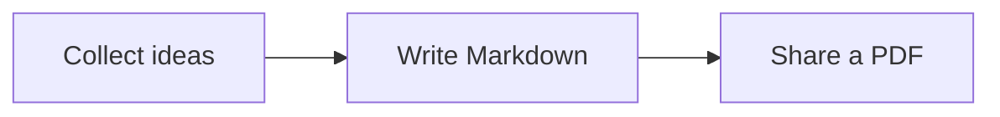

# Notes for a small project

Read notes, code and diagrams **offline**.



## A simple checklist

| Task | Status |
| :--- | :--- |
| Read the notes | Done |
| Share with the team | Next |

## A little code

```go
func main() {
    fmt.Println("Hello from Proview")
}
```

## Ready to share

Select and copy text, jump between headings or print the complete document.
