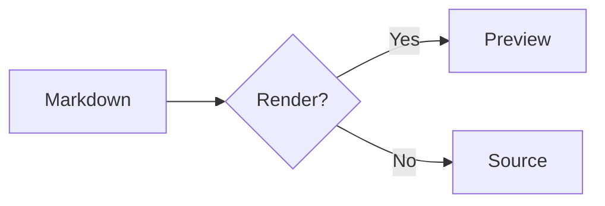
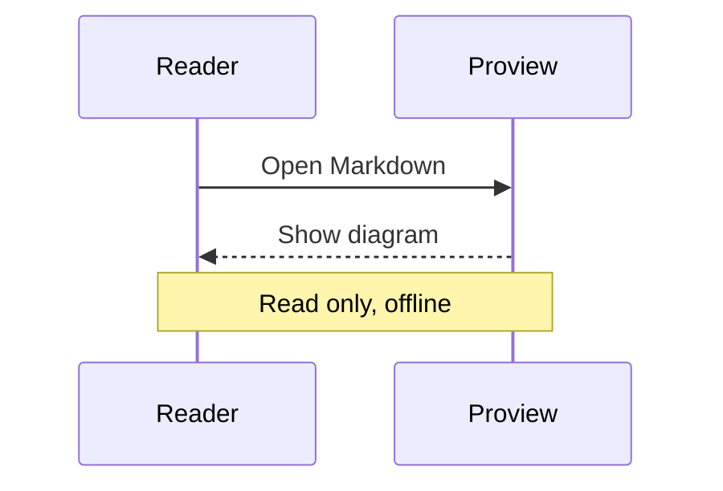

# Markdown in Proview

A native, read-only document with **bold**, *italic*, ***both styles***, ~~obsolete text~~ and `inline code`.

[Code example](#code-example) · [Project website](https://github.com/emanuelelongo/proview)

## A readable document

Paragraphs reflow when the window changes size. Text remains crisp, and zoom changes the reading size.

> A quotation can contain **emphasis**, a link and several lines of text.
>
> A second paragraph in the same quotation.

### Lists and tasks

3. Open a document.
4. Inspect its contents.
   - Nested item with **emphasis**.
   - Another nested item.
5. Keep the original file unchanged.

- [x] Native Markdown rendering
- [x] Syntax highlighting
- [x] Native Mermaid previews

## Tables

| Feature | Mode | Status |
| :--- | :---: | ---: |
| **Markdown** | Native | Available |
| Code | Read only | Highlighted |
| Images | Local | Supported |

## Code example

```go
package main

import "fmt"

func main() {
    message := "Hello from Proview"
    fmt.Println(message) // A syntax-highlighted comment
}
```

```python
for index in range(3):
    print(f"Document {index}")
```

```unknown-language
Unknown languages remain readable as plain code.
```

---

## Mermaid diagrams





## Deferred syntax stays visible

A formula stays as source: $E = mc^2$.

<details>
<summary>HTML source</summary>
This disclosure expands to show Markdown content without executing scripts.
</details>
